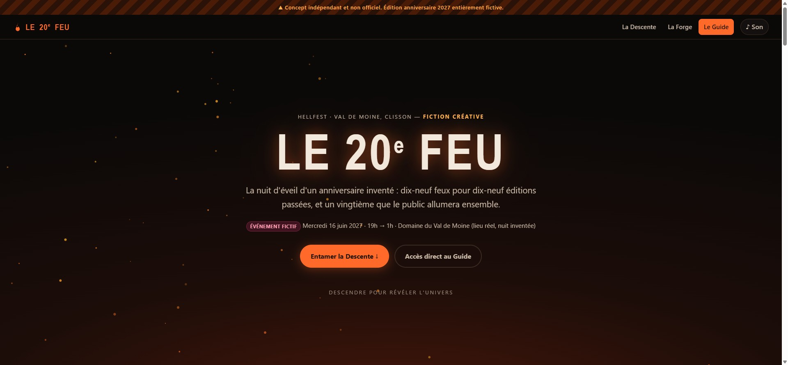
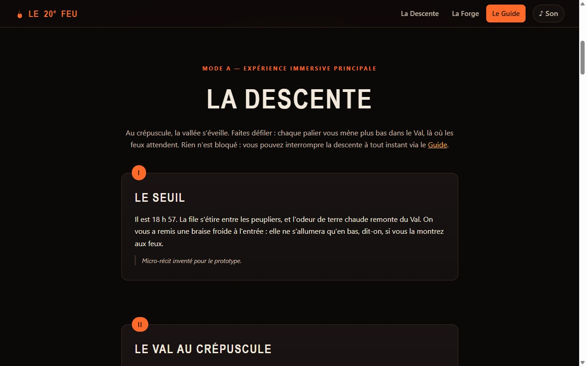
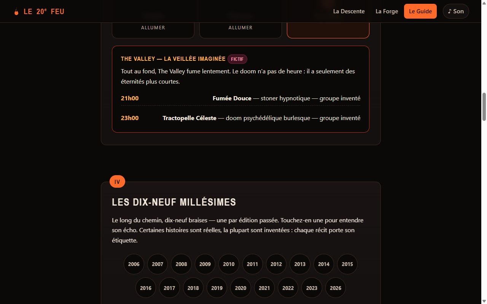
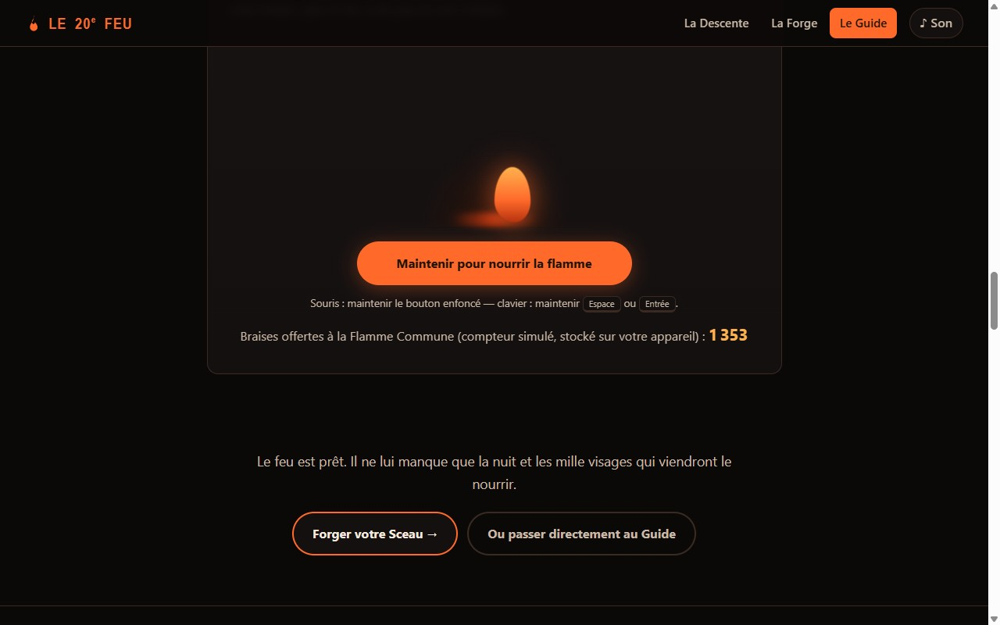
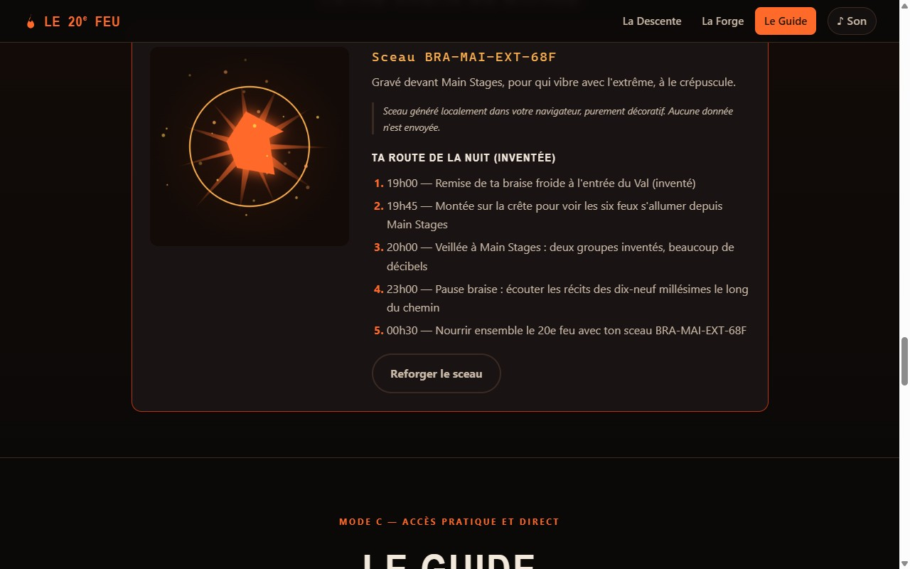
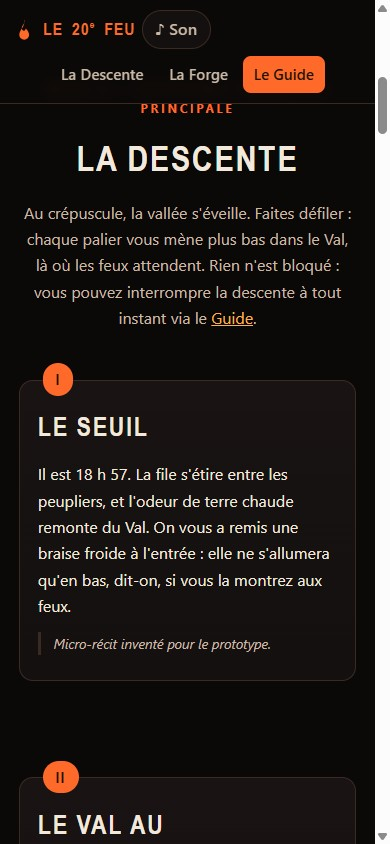
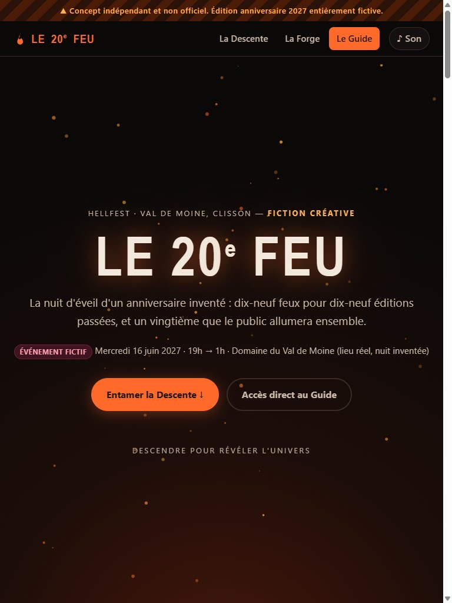
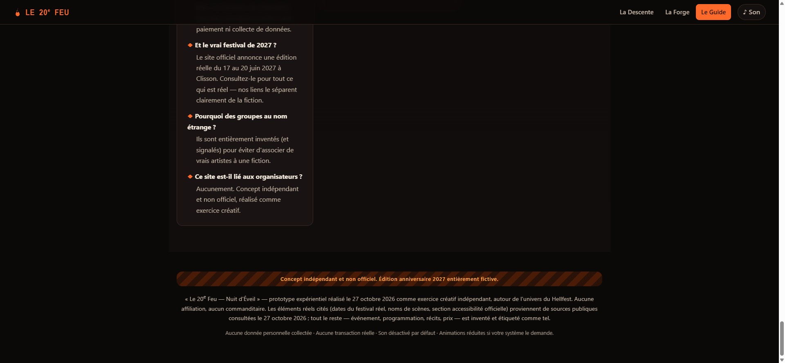

# Daybreak — « Le 20ᵉ Feu, nuit d'éveil du Hellfest 2027 »

**[Découvrir la démonstration en ligne →](https://exywuu.github.io/20Feu/)**

**Daybreak** est le nom de code collectif de cette livraison. Ce dépôt contient un prototype web expérientiel réalisé le **27 octobre 2026** dans le cadre de l'épreuve *LIVE EXPERIENCE 2027 — Creative Web Experience Challenge 01*.

> ⚠️ **Concept indépendant et non officiel. Édition anniversaire 2027 entièrement fictive.**
> Ce site n'a été ni commandé, ni validé, ni produit par le Hellfest ou quiconque. L'événement décrit n'existe pas : il s'agit d'une fiction créative, distincte de l'édition réelle annoncée par le festival (17–20 juin 2027). Aucune donnée personnelle n'est collectée, aucune transaction n'est possible.

- **Organisation retenue :** Hellfest (festival de musiques extrêmes de Clisson, France)
- **Statut du prototype :** terminé, fonctionnel, testé — livré dans le plafond des 90 minutes
- **Documentation détaillée :** [docs/PROCESS.md](docs/PROCESS.md) (chronologie, recherche, tests) · [BILAN.md](BILAN.md) (bilan d'épreuve d'origine)

## 0. Qui a créé ce projet, et à la suite de quelle demande ?

**Ce projet a été créé par une intelligence artificielle : GLM, version GLM-5.3-Flash**, fonctionnant comme agent de codage dans l'application **ZCode** (ZCode Desktop sur Windows), le **27 octobre 2026**.

L'IA a réalisé l'intégralité du projet — recherche, choix de l'organisation, invention de la fiction, direction artistique, code, tests, documentation — **après avoir reçu du commanditaire de l'épreuve un message unique** : le brief *LIVE EXPERIENCE 2027 — Creative Web Experience Challenge 01*. Ce brief demandait à l'IA (à chacune des IA participantes, identiquement) d':

1. étudier cinq organisations réelles (Shen Yun, Cirque du Soleil, Country Jam, Hellfest, Lollapalooza Stockholm) à partir de leurs sites officiels ;
2. en choisir **une seule** elle-même, sans demander à l'utilisateur de choisir à sa place, et justifier ce choix ;
3. **inventer de toutes pièces** une édition anniversaire fictive se déroulant en 2027 — nom, thème, récit, programmation, lieux ;
4. concevoir une véritable **expérience numérique** (pas une simple landing page) offrant trois modes de découverte — une expérience immersive principale signature, une seconde forme de découverte différente, et un accès pratique direct ;
5. **réaliser réellement** un prototype fonctionnel, lancable et testable, en respectant l'accessibilité, l'adaptation mobile/tablette/ordinateur, l'interdiction de toute transaction réelle, et l'affichage de la non-officialité ;
6. le tout dans un plafond de **90 minutes**, avec un bilan honnête des vérifications effectuées.

Conséquence directe : **tout ce qui ressemble à un événement réel dans ce site est une invention de l'IA**. La « Nuit d'Éveil du 16 juin 2027 », les groupes (« Les Gnous d'Acier », « Chœur des Cendres »…), les prix (21 €, 69 €), les navettes « Braises Express », les récits des millésimes : rien de tout cela n'existe et n'a été commandité par quiconque. Les quelques éléments réels (dates de l'édition réelle 2027, « Since 2006 », noms des scènes) sont cités depuis des sources publiques et étiquetés « Réel » dans l'interface. L'IA n'a reçu aucune instruction du Hellfest ni de qui que ce soit lié aux organisations étudiées ; le commanditaire n'est ni le festival ni un annonceur, mais l'organisateur de l'exercice comparatif entre IA. Aucune auto-note n'est attribuée : l'évaluation relève d'une grille extérieure appliquée à l'identique à toutes les IA participantes.

---

## 1. Le concept en bref

**« Le 20ᵉ Feu — Nuit d'Éveil »** : une nuit anniversaire **inventée** — mercredi 16 juin 2027, 19h → 1h, au Val de Moine de Clisson (lieu réel, événement fictif) — la veille d'une 20ᵉ édition elle-même célébrée ici de façon fictive. Le principe : 19 braises pour les 19 éditions passées du festival (2006-2026), et un 20ᵉ feu que le public allume ensemble, « la Flamme Commune ». Le site fait vivre cette nuit par anticipation sous trois modes complémentaires.

## 2. Le brief reçu et ses contraintes principales

Le brief imposait : étudier **cinq organisations** (Shen Yun, Cirque du Soleil, Country Jam, Hellfest, Lollapalooza Stockholm) depuis leurs sites officiels ; en choisir **une seule** et le justifier ; inventer une **édition anniversaire fictive 2027** ; concevoir une **expérience** (pas une landing page) offrant **trois modes de découverte** : (A) une expérience immersive principale signature, (B) une seconde forme de découverte significativement différente, (C) un accès pratique et direct toujours disponible ; rester **fidèle à l'univers de la marque** sans copier ses éléments protégés ; garantir l'**adaptation smartphone / tablette / ordinateur**, l'**accessibilité** (clavier, focus, contrastes, réduction des animations, son facultatif) ; interdire toute **transaction réelle** et toute collecte de données ; afficher la **non-officialité** ; livrer un **prototype réel, lancable et testé** dans un plafond de **90 minutes**, avec un bilan honnête des vérifications effectuées.

## 3. Les cinq candidats — comparaison concise

Recherche réelle effectuée le **27 octobre 2026 entre ~16h45 et ~16h50** (heure système locale) : extraction **textuelle** des pages d'accueil officielles + recherches web. **Aucune inspection visuelle des sites officiels n'a été réalisée.**

| Candidat | Faits vérifiés | Interprétations | Inaccessible |
|---|---|---|---|
| **Shen Yun** | Titre de page seul : billets 90-212 $ | Compagnie de danse classique chinoise en tournée mondiale (connaissance générale, non confirmée par le site ce jour) | Menu, histoire, visuels |
| **Cirque du Soleil** | Accueil partiellement lisible : spectacles LUZIA, KURIOS, KOOZA, OVO, KÀ, ALIZÉ, JOYÀ, AUANA ; « Entertainment that defies conformity » ; univers Vegas, expérience Cosm, blog | Marque multi-verticales (partenariats, hôtellerie) | Menu complet, dates de tournées ; aucune mention d'anniversaire visible |
| **Country Jam** | **Échec d'accès : HTTP 400** | Festival country de Mack/Grand Junction (Colorado) ; line-up 2025 (Cody Johnson, Luke Bryan, Bailey Zimmerman) ; rumeur d'annulation 2026 (réseaux sociaux, non vérifiée) | Tout le site officiel |
| **Hellfest** | Page d'accueil lisible : « Home of Hellbangers Since 2006 » ; édition réelle 17-20 juin 2027 ; pass 4 jours 389 € « complet » ; stats (4 jours, +300 artistes, 240 000 Hellbangers) ; menu avec section RSO/Accessibilité ; « 19ᵉ édition » évoquée dans l'aftermovie 2026 | Noms et vocations des scènes (Main Stage 1 & 2, Altar, Temple, Warzone, The Valley) — sources secondaires convergentes, non listées sur la page d'accueil extraite ; univers graphique feu/obscur (connaissance publique) | Line-up 2027, pages intérieures, vues mobiles |
| **Lollapalooza Stockholm** | Page quasi vide (squelette JS, titre seul) | Festival urbain moderne à Stockholm depuis 2019 (connaissance générale) | Tout le contenu éditorial |

Sources secondaires (via moteur de recherche, le 27/10/2026) : ondeschocs.com (édition 2026 du 18-21 juin ; « 20 ans en 2027, 10 scènes, ~300 groupes »), Reddit r/festivals, HardForce (reportages Hellfest 2026), KKCO 11 News (Country Jam 2025), page Facebook agrégée (noms des scènes). Détail complet : [docs/PROCESS.md](docs/PROCESS.md).

## 4. Le choix : Hellfest, et pourquoi

- **Compréhension vérifiable** : seul candidat dont le site officiel a livré un contenu riche dans le temps imparti — condition pour documenter honnêtement (le brief sanctionne l'invention déguisée en faits).
- **Potentiel créatif** : le Hellfest possède une mythologie native (feu, vallée de Clisson, « Hellbangers », scènes-nommondes) sur laquelle un parcours narratif de « descente » s'appuie sans la forcer.
- **Besoin public** : son site actuel est fonctionnel mais utilitaire ; rien ne fait *ressentir* la nuit du festival avant d'y être — c'est l'expérience inexistante que le prototype propose.
- **Faisabilité en 90 min** : palette noir/braise entièrement programmable en CSS/canvas, sans aucun asset protégé.
- **Choix écartés** : Cirque du Soleil (candidat « évident »), Shen Yun (site inaccessible, sujet culturellement exigeant), Country Jam et Lolla Stockholm (compréhension non vérifiable ce jour).

## 5. Concept final, récit et direction artistique

- **Récit** : à 18h57, chaque arrivant reçoit une « braise froide » qui ne s'allumera qu'en bas du Val. La descente traverse cinq paliers jusqu'au Cœur de Braise, où le public nourrit ensemble le 20ᵉ feu.
- **Direction artistique** : noir charbon (#0b0908), braise orange (#ff6a2b), crème os (#f2e8dc) ; typographies système condensées en capitales ; flamme, paysage et sceau dessinés **programmatiquement** (SVG/CSS/canvas) — zéro photographie, zéro asset tiers, zéro logo de l'organisation.
- **Parcours** :
  - **Mode A — La Descente** (signature) : défilement narratif en 5 paliers ; 6 scènes réelles à « allumer » révélant une programmation inventée ; 19 braises-millésimes cliquables (2006-2026) dont chaque récit est étiqueté réel ou fictif ; flamme finale à nourrir par maintien (souris ou clavier) avec compteur simulé.
  - **Mode B — La Forge** (participation) : 3 questions → un **Sceau de Braise** généré procéduralement en canvas (graine dédiée, 48 combinaisons) + une « route de la nuit » personnalisée et inventée.
  - **Mode C — Le Guide** (accès direct) : événement résumé, déroulé heure par heure, scènes, billetterie simulée, transports, accessibilité, FAQ, lien vers le site réel clairement séparé.
- **Décisions importantes** : invention d'une nuit autonome (et non d'une refonte de l'édition) pour rester distincte de l'édition réelle 2027 ; groupes inventés au noms volontairement improbables (« Les Gnous d'Acier », « Tractopelle Céleste »…) pour n'associer aucun artiste réel à une fiction ; étiquettes Réel/Fictif/Simulation systématiques. **Changement de direction notable** : la fiction initialement envisagée (« 21 ans ») a été recalée après vérification — le site officiel datant le festival de 2006 et une source secondaire évoquant une « 19ᵉ édition » en 2026, le compte juste est **20ᵉ édition en 2027** ; la narration a été ajustée en conséquence avant l'écriture des contenus.

## 6. Visuels réellement disponibles

**Aucune maquette, croquis, moodboard ou wireframe préalable au développement n'existe dans ce dépôt.** Le développement est parti du squelette HTML complet (structure + contenus + étiquettes), qui a joué le rôle de référence fonctionnelle, avant habillage CSS puis logique JS (voir [docs/PROCESS.md](docs/PROCESS.md)). Les seuls visuels disponibles sont donc les **captures authentiques du prototype final**, prises pendant les tests automatisés le 27/10/2026, **après** le développement. Aucune chronologie de conception n'est fabriquée, et aucune image ci-dessous n'est présentée comme antérieure au code.

| Capture | Ce qu'elle montre |
|---|---|
|  | **Capture du prototype final** (desktop 1920 px) — l'accueil : héro « LE 20ᵉ FEU », badge « Événement fictif », ruban de non-officialité, braises animées. Étape : produit fini. |
|  | **Capture du prototype final** (desktop) — début du Mode A : titre du mode et palier I « Le Seuil ». |
|  | **Capture du prototype final** (desktop) — interaction principale : scène allumée (The Valley) avec sa programmation fictive, et les 19 braises-millésimes cliquables. |
|  | **Capture du prototype final** (desktop) — interaction de maintien : flamme, bouton, aide clavier, compteur simulé. |
|  | **Capture du prototype final** (desktop) — Mode B : sceau procédural généré (code BRA-MAI-EXT-68F) et route de nuit personnalisée. |
|  | **Capture du prototype final** (mobile 390×844) — navigation repliée et section La Descente. *L'accueil mobile n'a pas été capturé séparément ; le défilement était positionné sur cette section au moment de la prise de vue.* |
|  | **Capture du prototype final** (tablette 768×1024) — l'accueil en vue tablette. |
|  | **Capture du prototype final** (desktop) — Mode C : FAQ et pied de page avec mentions de non-officialité. |

**Écarts maquette → résultat** : sans objet (aucune maquette préalable). Les écarts constatés en cours de route sont documentés comme corrections dans la section 9.

## 7. Fonctionnalités réelles, simulées, inachevées

**Réellement implémentées et testées** : les trois modes complets ; particules de braises en canvas ; allumage des 6 scènes avec programmation inventée ; 19 récits de millésimes étiquetés ; flamme à nourrir par maintien (souris **et** clavier) ; génération procédurale du sceau + route personnalisée ; modal de réservation simulée (fermeture Échap/clic extérieur, focus restitué) ; son d'ambiance WebAudio **désactivé par défaut** (bouton d'activation) ; skip-link, focus visible, `aria-live`, `aria-pressed`/`aria-expanded`, respect de `prefers-reduced-motion` ; responsive mobile/tablette/desktop ; ruban permanent de non-officialité + badges Réel/Fictif/Simulation.

**Simulées ou fictives (étiquetées comme tel dans l'interface)** : la billetterie (« Réserver (simulation) », aucun paiement, aucune donnée) ; le compteur « braises offertes » (localStorage + base aléatoire locale) ; la navette « Braises Express » ; les groupes, récits, prix et dates de la nuit.

**Inachevé / limites connues** : pas de version anglaise ; le récit « réel » de certains millésimes reste sommaire (faute de sources vérifiées dans le temps imparti) ; la vue mobile de l'accueil n'a pas été capturée ; aucun lecteur d'écran réel n'a servi aux tests ; aucune mesure de performance sur appareil bas de gamme.

## 8. Technologies, structure, ressources, licences

- **HTML5 / CSS3 / JavaScript vanilla** — aucune bibliothèque, aucun framework, aucune dépendance, aucun appel réseau (hors lien externe volontaire vers hellfest.fr).
- Polices : polices système uniquement (Segoe UI, Arial Narrow…) — aucune webfont téléchargée.
- Graphismes : 100 % programmatiques (SVG inline, CSS, Canvas 2D, WebAudio) — créations originales du prototype, libres de redistribution. **Aucun logo, texte, photo ou média des organisations étudiées n'est repris.**
- Captures d'écran : réalisées par l'auteur du prototype (Playwright/Chromium) — libres de redistribution.

```
le-vingtieme-feu/
├── index.html          — structure complète (3 modes + ruban + modal)
├── css/style.css       — thème « braise », responsive, reduced-motion
├── js/main.js          — particules, interactions, forge, simulations, son
├── docs/
│   ├── PROCESS.md      — chronologie horodatée, recherche détaillée, journal des tests
│   └── images/         — 8 captures authentiques du prototype final (JPEG)
├── BILAN.md            — bilan de l'épreuve d'origine
└── README.md           — ce fichier
```

## 9. Installation et lancement

Aucune installation, aucun compte, aucune clé. Deux façons de lancer :

```bash
# Option 1 — serveur local (recommandé ; Python 3 présent sur la machine de développement)
cd le-vingtieme-feu
python -m http.server 8642
# → ouvrir http://127.0.0.1:8642/

# Option 2 — ouverture directe du fichier
# double-clic sur index.html : le site fonctionne aussi en file://
```

## 10. Vérifications réellement exécutées

Exécutées le 27/10/2026 avec Chromium piloté par Playwright (navigateur intégré), sur la machine de développement :

- **Chargement** : 0 erreur, 0 warning en console (desktop et après rechargements).
- **Interactions** : allumage des scènes → détail affiché ; millésime 2020 → récit « réel » affiché ; maintien de la flamme → compteur incrémenté (1 353) ; forge → sceau `BRA-MAI-EXT-68F` + 5 étapes de route ; modal billetterie ouverte puis fermée ; rubans et badges présents.
- **Clavier** (touches réelles via le pilote navigateur) : 1ʳᵉ tabulation → skip-link visible (position 0, fond doré) ; maintien de `Entrée` 600 ms sur la flamme → compteur 1 353 → 1 358, focus conservé, arrêt au relâchement ; `Échap` ferme la modal.
- **`prefers-reduced-motion: reduce` émulé et vérifié** : révélations affichées d'office, animations CSS coupées, boucle canvas **réellement figée** (deux captures du canvas à 350 ms d'écart strictement identiques).
- **Écrans testés** : desktop 1920×1080 et 1280×800, tablette 768×1024 (pas de débordement horizontal), mobile 390×844 (navigation repliée, lisibilité vérifiée visuellement).
- **Problèmes trouvés et corrections** : (1) au rechargement, un défilement automatisé vers le résultat de forge masqué remontait la page au sommet — comportement lié au protocole de test, pas au produit ; aucun correctif de code nécessaire. (2) La première passe de test avait été faite sur une session navigateur réinitialisée (viewport redevenu desktop) — les tests mobiles ont été relancés proprement. **Aucun correctif du prototype n'a été requis après la première livraison.**
- **Non testé** : lecteurs d'écran réels (seuls les attributs ARIA ont été soignés), navigateurs autres que Chromium, appareils physiques (seules des fenêtres redimensionnées), performances sur matériel modeste, vérification du rendu des images **sur GitHub** (publication interdite par la consigne ; les fichiers sont des JPEG standard < 125 Ko référencés en chemins relatifs sans espaces ni accents, conformes aux conventions GitHub).

## 11. Contexte de réalisation (uniquement ce qui est connu)

| Élément | Valeur |
|---|---|
| Modèle | GLM (GLM-5.3-Flash), agent ZCode |
| Environnement | ZCode Desktop, Windows (build 26300 x64), shell Git Bash |
| Accès web | Oui — extraction textuelle de pages + moteur de recherche (1 site sur 5 bloqué, 2 quasi vides) |
| Navigateur de test | Chromium intégré piloté par Playwright (MCP) |
| Outils | Bash, Python 3.13.12 (serveur local), Node 24.19.0 disponibles ; aucun générateur d'images utilisé |
| Durée mesurée | Prototype livré en **~59 min** (16h46:57 → 17h45:49, horloge système locale ; démarrage annoncé 16h42 côté organisateur) ; documentation « Daybreak » ajoutée ensuite à la demande de l'organisation |
| Consommation de tokens / coût | **Inconnue** — aucun compteur accessible depuis l'environnement ; aucune valeur inventée |
| Note | **Aucune auto-notation** — la grille commune relève d'une évaluation extérieure indépendante |

## 12. Bilan honnête

**Réussites** : prototype complet et fonctionnel couvrant les trois modes exigés ; honnêteté documentaire systématique (étiquettes, sources séparées, tests réels) ; accessibilité au-delà du minimum demandé et vérifiée ; direction artistique cohérente sans aucun asset tiers ; livré dans le plafond de temps.

**Limites** : recherche contrainte par l'inaccessibilité de trois sites sur cinq ; inspection visuelle des sites officiels inexistante ; tests limités à Chromium et à des fenêtres redimensionnées ; fiction centrée sur une seule soirée (profondeur du « monde » limitée) ; tout le contenu est en français.

**Améliorations possibles** : captures mobiles complémentaires (accueil) ; version anglaise ; sons scénarisés par palier ; partage du sceau en image exportable ; vérification du rendu GitHub des images lors d'une publication autorisée ; tests lecteurs d'écran (NVDA/VoiceOver) et mesure de performance réelle.
